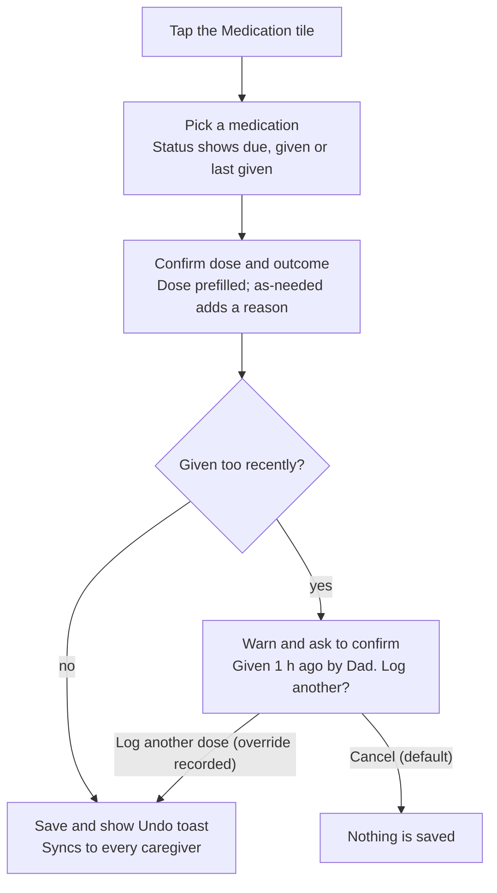
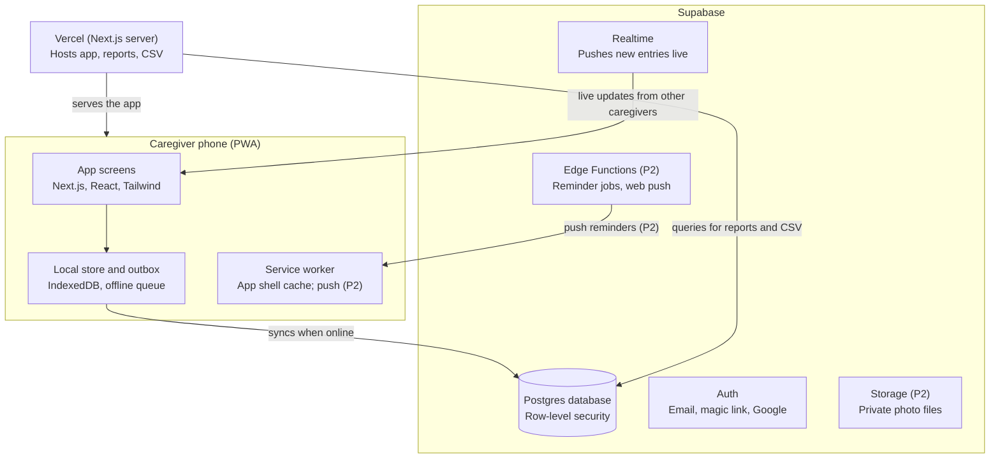

# Behavior Logger — Product Requirements (v0.1)

Oct 26, 2026 · @David Rodriguez

> Markdown copy of the [Behavior Logger PRD doc](https://claude.ai/artifact/52FEA8ZNRNvhjWr1nYd8Pu), exported Oct 26, 2026. The doc is the source of truth; its diagrams appear here as a table and Mermaid blocks.

## 1. Summary

Behavior Logger is a mobile-first web app that lets caregivers log bathroom, eating, activities, mood and medications in three taps or fewer. It turns those logs into trends, patterns and doctor-ready reports.

- **Who logs:** parents and caregivers of babies, children, and teens or adults with special needs. That includes grandparents, nannies, aides and paid support staff.
- **Who reads:** pediatricians, specialists, therapists and school teams, through exported reports.
- **The core bet:** tap, don't type. Every required input is a button, defaults handle the rest, and free text is always optional.
- **MVP:** a shared household with care profiles, Quick Log for all five modules, and medication schedules with double-dose protection. It also includes a timeline with undo, a dashboard (Today, Trends, Patterns) and PDF/CSV reports. It installs to the home screen and logs offline.
- **Later:** push reminders, sleep and behavior-incident tracking, photos, clinician share links, Spanish and native apps (section 6).
- **For Claude Code:** build every P0 requirement, then P1. P2 and P3 items are context only, so the data model and navigation leave room for them.
- **Priority key:** P0 = MVP must-have · P1 = MVP if time allows · P2 = Phase 2 · P3 = Phase 3.
- **Decide before build:** cloud sync vs. a local-only prototype, sign-in methods and the tech stack. A clinical reviewer must be named before the pilot (section 15).

## 2. Problem

Caregivers are asked for precise history at every appointment, and today they answer from memory, paper or scattered phone notes.

- **Recall is unreliable.** "How many BMs this week?" or "Has mood changed since the new medication?" usually gets a guess.
- **Care is shared, data is not.** Two parents, a grandparent and a school aide each hold a piece of the day. Nobody sees the whole picture.
- **Medication mix-ups happen at handoffs.** "Did someone already give the Tylenol?" is a daily question in homes with several caregivers.
- **Typing is the barrier.** A caregiver holding a baby, or calming a child mid-meltdown, will not fill in a form.

The opportunity is one app that works from newborn to adult, is fast enough to use one-handed, and turns daily taps into evidence a care team can act on. A competitive scan of baby trackers and special-needs tools is a recommended follow-up.

## 3. Goals, non-goals and success metrics

The MVP succeeds if caregivers log daily without friction and bring a report to at least one appointment during the pilot.

| Goal | Metric | MVP target |
| --- | --- | --- |
| G1 Logging is effortless | Median taps per log; median seconds from tile tap to saved | ≤ 3 taps; ≤ 5 s |
| G2 Caregivers keep logging | Households logging on 5+ of 7 days, pilot weeks 2–4 | ≥ 60% |
| G3 Care is shared | Households with 2+ active caregivers | ≥ 40% |
| G4 Data reaches the care team | Pilot households that export or share a report with a clinician | ≥ 70% |
| G5 Fewer medication errors | Duplicate-dose warnings that end in Cancel | Tracked, no target yet |
| G6 Insights are understood | Pattern cards rated helpful | ≥ 70% |
| G7 Easy to learn | System Usability Scale (SUS) score | ≥ 80 |

Targets assume a 4-week pilot with 10–20 families and should be recalibrated afterward.

**Non-goals for the MVP**

- Not a medical device: no diagnosis, no treatment advice, no dose calculation.
- No EHR integration (Epic, FHIR) and no clinician-side data collection or billing.
- No native iOS or Android apps; the installable web app covers home-screen use.
- No AI-written health interpretation.
- No community or social features.

## 4. Users and personas

The people who log are adult caregivers. Clinicians and school teams read the exported reports and need no account in the MVP.

| Persona | Context | Must-haves |
| --- | --- | --- |
| Parent of a baby (0–12 months) | Sleep-deprived, one hand free, often logging at night | One-tap diaper and feed logs, feed timer, night mode, "last fed" and "start on" side at a glance |
| Parent of a child with special needs | Juggles therapies, school and medications; sees several specialists | Mood and behavior tags, BM and constipation tracking, scheduled meds, reports for doctor, therapist and school/IEP team |
| Caregiver of a teen or adult with disabilities | Family member or paid support staff, often working in shifts | Medication record showing who gave what, BM tracking, respectful adult wording, a timeline that supports shift handoffs |
| Occasional caregiver | Grandparent, sitter or respite worker with no training | Zero-learning screens, a Care card (allergies, calming tips, contacts), limited permissions |
| Clinician, therapist or school team (reader) | A few minutes per visit; wants dated facts, not anecdotes | One-page summary, medication changes shown against trends, CSV for their own analysis |

The person being logged about matters too. Wording adapts to the care stage, and an adult is never described in baby language.

## 5. Product principles

Every screen must pass these eight rules, and each one carries a check that can be tested.

1. **Tap, don't type.** Required inputs are buttons, chips or steppers.
   - Check: no required text field exists outside setup (names of people, medications and custom options).
2. **Three taps to log.** Tile, choice, Save. Favorites cut it to one tap.
   - Check: every module's primary log completes in 3 taps or fewer.
3. **Smart defaults.** Time defaults to now, and last-used values are preselected.
   - Check: logging the same bottle amount as last time needs no extra taps.
4. **Forgiving.** Every save can be undone, and any entry can be edited or backdated.
   - Check: an Undo toast stays up for at least 5 seconds after each save.
5. **Right person, every time.** The active profile's name and color appear on every log screen and confirmation.
   - Check: the confirmation toast names the profile.
6. **One-handed and low-light.** Primary actions sit in the bottom half of the screen, with dark and night modes.
   - Check: Save buttons are sticky at the bottom of every sheet; primary targets are at least 48 × 48 px.
7. **Plain-language insights.** Charts lead with a sentence, such as "BMs down 40% vs. last week." Patterns are observations, never diagnoses.
   - Check: every chart has a headline, and every pattern card shows its sample size and a not-medical-advice note.
8. **Private by default.** The family owns the data, and sharing is explicit, scoped and revocable.
   - Check: no third-party script receives health data.

## 6. Scope and phasing

| Phase | Focus | Includes | Gate to the next phase |
| --- | --- | --- | --- |
| Phase 1: MVP | Log, learn, share reports | Profiles and shared household; Quick Log for all 5 modules; meds with double-dose guard; timeline, undo, edit; Today, Trends, Patterns; PDF and CSV reports; works offline and installs | Gate 1, pilot results: 60%+ of households log 5 of 7 days; SUS 80+; reports shared with clinicians |
| Phase 2 | Remind and share securely | Push reminders and refills; sleep tracking; behavior incidents (ABC); photo attachments; clinician share links; Spanish and custom trackers; app lock and Apple sign-in | Gate 2, proven demand: retention holds in Phase 2; provider or agency interest |
| Phase 3 | Integrate and scale | Native app wrappers; health data integrations; FHIR export; AI weekly summary; agency multi-client tier; medication name lookup; voice logging | None (final phase) |

Each phase starts only when the gate before it is met. In section 8, P0 and P1 items belong to Phase 1, P2 items to Phase 2 and P3 items to Phase 3.

## 7. Navigation and core flows

Five bottom tabs keep every task one tap from Home, and giving a medication is the only flow that branches.

| Tab | What it holds |
| --- | --- |
| Log (home) | Module tiles, favorites and banners |
| Timeline | The day-by-day record, with edit and delete |
| Insights | Today, Trends and Patterns |
| Reports | Report builder, exports and appointment dates |
| More | Profiles, Care card, caregivers and settings |

The profile switcher sits in the header on every screen. On tablet and desktop, the tabs become a left sidebar and Insights shows several charts per row.

**Onboarding, under 2 minutes**

1. Sign up with email, or Google once available.
2. Create the first profile: name, care stage or date of birth, and color.
3. Confirm the modules, pre-checked by care stage.
4. Optionally add medications and invite a caregiver.
5. Land on Quick Log with three one-line tips.

**Quick log, any module**

1. Tap a tile.
2. Pick the option or options; details stay optional.
3. Tap Save and see the toast with Undo.

**Give a medication**



The check uses the minimum interval set for that medication, or 60 minutes when none is set (MED-07).

**Export a report**

1. Open Reports and pick the profile, date range and template.
2. Preview the report and toggle sections.
3. Print or save as PDF, or export CSV, then share.

## 8. Functional requirements

### 8.1 Profiles, caregivers and roles

A household holds care profiles and caregivers. Every entry belongs to one profile and records who logged it.

| ID | Requirement | Priority | Acceptance criteria |
| --- | --- | --- | --- |
| ACC-01 | Sign up and sign in with email, by magic link or password. | P0 | A new user reaches "create first profile" in under 60 s; sessions persist until sign-out. |
| ACC-02 | Sign in with Google. | P1 | Works inside the installed app on iOS and Android. |
| ACC-03 | Sign in with Apple. | P2 | Same as ACC-02. |
| ACC-04 | A household is created at sign-up, and its creator becomes Admin. | P0 | Admin can rename the household. |
| ACC-05 | Create multiple care profiles: name (required), photo or initials, color, and date of birth or care stage. | P0 | Stages: Baby (0–12 months), Child (1–12 years), Teen/Adult (13+). Date of birth sets the stage, which can be overridden. |
| ACC-06 | Profile care settings: toileting (diapers or briefs, toilet training, uses toilet), feeding methods (breast, bottle, meals, tube) and enabled modules. | P0 | Defaults come from the care stage; any change updates Quick Log options immediately. |
| ACC-07 | Invite caregivers by email or share link as Admin or Caregiver. | P0 | Invites expire after 7 days; an accepted invite opens the active profile's Quick Log. |
| ACC-08 | Viewer role with read-only access. | P1 | Viewers see insights and export reports but cannot log. |
| ACC-09 | Enforce role permissions on the server. | P0 | Admin: everything. Caregiver: log, edit or delete own entries, view insights, export. Viewer: read and export. Out-of-role writes are rejected by the database, not just hidden in the UI. |
| ACC-10 | Remove a caregiver. | P0 | Access ends immediately; their past entries stay attributed to them. |
| ACC-11 | Each entry stores occurred-at (editable), logged-by and created-at. | P0 | The timeline shows caregiver initials on every entry. |
| ACC-12 | Care card per profile: allergies, conditions, communication notes, calming strategies, emergency and doctor contacts. | P1 | Reachable in 2 taps from any screen; all fields optional; can be included in reports. |
| ACC-13 | Archive and restore a profile. | P1 | Archived profiles leave the switcher, and their data stays exportable. |
| ACC-14 | Limit a caregiver's history access to entries after their start date. | P2 | Intended for paid staff; Admin sets the date. |

### 8.2 Quick Log (home screen)

Home is a grid of large tiles for the active profile, and logging anything takes one to three taps.

| ID | Requirement | Priority | Acceptance criteria |
| --- | --- | --- | --- |
| QL-01 | Home shows a large tile for each enabled module (Bathroom, Eating, Activity, Mood, Medication) for the active profile. | P0 | Tiles are at least 96 px tall; each shows the last entry ("Last BM 5 h ago") and any status ("1 med due"). |
| QL-02 | Tapping a tile opens a bottom sheet with single-tap options and a sticky Save button. | P0 | Primary options fit without scrolling on a 375 × 667 screen; targets are at least 48 × 48 px. |
| QL-03 | A time chip defaults to Now, with presets for 15 min, 30 min, 1 h and 2 h ago, plus Custom. | P0 | Custom opens a date-time picker; future times are blocked. |
| QL-04 | After saving, a toast shows the profile name, a summary, the time and Undo; the phone vibrates briefly where supported. | P0 | The toast stays at least 5 s; Undo removes the entry on every caregiver's device. |
| QL-05 | Optional "Add details" on every log: a note (keyboard dictation works) and a "Flag for doctor" toggle. | P0 | Collapsed by default and never required. |
| QL-06 | Last-used values are preselected per profile (bottle amount, starting breast side, meal portion). | P0 | Re-logging an identical entry needs no extra taps. |
| QL-07 | A profile switcher in the header shows avatar, name and color band; switching changes the app's accent color. | P0 | Switching takes 2 taps or fewer; each log sheet repeats the profile name in its title. |
| QL-08 | Home banners for meds due or overdue, alert thresholds and as-needed (PRN) follow-ups. | P0 | Each banner links to its action; a dismissed banner does not return for the same event. |
| QL-09 | Favorites row with up to 6 one-tap presets ("Wet diaper", "Bottle 4 oz", "Vitamin D"), saved from any entry. | P1 | One tap logs at the current time and shows the Undo toast. |
| QL-10 | "Same as last time" chip at the top of each module sheet. | P1 | One tap repeats the module's last entry with the time set to now. |
| QL-11 | Timers for breastfeeding and activities: start, keep running if the app closes, stop to save. | P1 | The timer stores its start time, so it survives app close and phone lock. |
| QL-12 | Reorder or hide Home tiles per profile. | P1 | Order persists per profile across devices. |
| QL-13 | Photo attachment on any entry (stool, rash, food). | P2 | Photos are stored privately behind signed URLs and excluded from CSV. |
| QL-14 | New modules: Sleep, Behavior incidents (ABC) and custom trackers, such as seizures. | P2 | Added as new entry types without a schema migration (section 11). |

### 8.3 Bathroom (bowel movements and urination)

One tile covers pee, BMs and dry diaper checks. Detail fields are optional and appear only when they fit the profile.

| ID | Requirement | Priority | Acceptance criteria |
| --- | --- | --- | --- |
| BTH-01 | Event type in one tap: Pee, BM, Both, Dry. | P0 | Type plus Save logs the entry (3 taps from Home). Dry appears only for diaper and toilet-training profiles. |
| BTH-02 | Where: Diaper/brief, Toilet, Accident. | P0 | Hidden for diaper profiles (defaults to Diaper/brief); toilet-training profiles see all three; toilet users default to Toilet. |
| BTH-03 | BM consistency on an age-appropriate scale. | P0 | Baby and Child profiles in diapers get 4 options (Watery, Soft, Formed, Hard) from the [Amsterdam Infant Stool Scale](https://www.em-consulte.com/article/336103/infant-stool-form-scale-development-and-results) ([categories](https://bmcnutr.biomedcentral.com/articles/10.1186/s40795-020-00365-4/figures/2)). Toilet users and all Teen/Adult profiles get Bristol Stool Form Scale types 1–7 with plain labels. The scale follows the toileting setting and can be switched. Icons are original drawings, not copies of published charts. |
| BTH-04 | BM size: Small, Medium, Large. | P1 | Optional; skipped values are stored as empty, not as a default. |
| BTH-05 | BM color swatches: Yellow, Green, Brown, Black, Red, White/pale/clay, Other. | P0 | Every swatch carries a text label; color is never the only cue. |
| BTH-06 | A calm information notice for colors worth a call. | P0 | Red, black (after the first week of life) or white/pale/clay show "Worth mentioning to your doctor" with a Flag for doctor button. For Baby profiles, white/pale/clay reads "Pale, white or clay-colored stool in a baby should be reported to your baby's doctor promptly, especially with yellow skin or eyes" ([BC biliary atresia screening](https://www.perinatalservicesbc.ca/our-services/screening-programs/newborn-screening-bc/biliary-atresia-screening)). Final wording is clinician-reviewed. |
| BTH-07 | Flags (multi-select): Straining/pain, Blood, Mucus, Diaper rash, Blowout/leak. | P1 | Selecting Blood also shows the BTH-06 notice. |
| BTH-08 | Days since last BM on the tile and Today card, with an alert past a caregiver-set threshold. | P0 | Default 3 days, adjustable or off; the alert appears as a Home banner. |
| BTH-09 | Wet-diaper minimum alert for babies: "Fewer than N wet diapers by \[time\]." | P1 | Off by default; the caregiver sets N and the time on their pediatrician's advice. |
| BTH-10 | Toilet-training progress: toilet vs. accident counts per day. | P1 | Feeds the chart in DSH-03. |

### 8.4 Eating and drinking

The sheet shows only the feeding methods enabled for the profile, so a baby sees breast and bottle while an adult sees meals and drinks.

| ID | Requirement | Priority | Acceptance criteria |
| --- | --- | --- | --- |
| EAT-01 | Method buttons per profile: Breast, Bottle, Meal, Snack, Drink. | P0 | Only methods enabled in the profile's feeding settings appear. |
| EAT-02 | Breastfeeding: Left, Right or Both, duration chips (5, 10, 15, 20, 30 min) and a "Start on: Right" hint. | P0 | The hint reflects the last logged side; the timer option is QL-11. |
| EAT-03 | Bottle: contents (Breast milk, Formula, Other) and amount chips with a ± stepper. | P0 | oz chips: 1, 2, 3, 4, 5, 6, 8. ml chips: 30, 60, 90, 120, 150, 180, 240. Stored in ml, shown in the user's unit, last amount preselected. |
| EAT-04 | Meal or snack: meal type auto-picked by time of day, plus amount eaten (None, A little, Half, Most, All). | P0 | Portion maps to 0, 25, 50, 75 or 100%; plate icons fill to match; meal type stays editable. |
| EAT-05 | Drinks: Water, Milk, Juice, Other, with amount chips. | P0 | Cups or oz/ml per settings; stored in ml. |
| EAT-06 | Reactions (optional chips): Refused, Gagged, Vomited/spit up, Rash/hives, Fussy, Coughing/choking, Trouble breathing or swelling. | P0 | Trouble breathing or swelling shows "If this is happening now, call 911." Reactions appear under flagged events in reports. |
| EAT-07 | Food groups (optional chips): Fruit, Vegetables, Grains, Protein, Dairy, Sweets/snacks. | P1 | Multi-select; feeds the food-group mix in Trends. |
| EAT-08 | Foods picked from a personal list, recent and favorites first; adding a new food is the only typing. | P1 | Each food tracks accepted vs. refused for the "most accepted / most refused" insight. |
| EAT-09 | "New food" toggle for food introductions. | P1 | New foods appear as dated markers in eating Trends. |
| EAT-10 | Tube feeding: formula from a saved list, volume (ml), method (bolus or continuous/pump), optional water flush (ml). | P1 | Enabled per profile; daily totals shown in Trends. |
| EAT-11 | Appetite: Poor, Normal, Hungry. | P2 | Optional chip row on meals. |

### 8.5 Activities

Activities capture what the person does and how much they enjoy it, so caregivers and therapists can see what engages and calms them.

| ID | Requirement | Priority | Acceptance criteria |
| --- | --- | --- | --- |
| ACT-01 | Activity picker: icon tiles from a default library by care stage (Appendix A), plus custom activities. | P0 | A custom activity needs only a name and an icon, then appears as a tile; most-used activities sort first. Therapy sessions (OT, speech, ABA, PT) are in the library. |
| ACT-02 | Enjoyment rating on five faces: Disliked, Not into it, Okay, Enjoyed, Loved it. | P0 | Shown right after an activity is picked; skippable, and saved as "not rated" when skipped. |
| ACT-03 | Duration chips (5, 15, 30, 60, 90+ min) or a timer. | P1 | Timer behaves as in QL-11. |
| ACT-04 | With whom (Alone, Family, Peers, Therapist/teacher, Group) and setting (Home, School, Outdoors, Community, Therapy). | P2 | Optional chip rows under Add details. |

### 8.6 Mood and behavior

Mood is one tap on a five-face scale, with feelings and notable behaviors as optional chips underneath.

| ID | Requirement | Priority | Acceptance criteria |
| --- | --- | --- | --- |
| MOOD-01 | Mood level (required) on a five-face scale whose labels adapt to the care stage (Appendix A). | P0 | Stored as 1–5; several mood logs per day are allowed. |
| MOOD-02 | Feelings (optional multi-select) from a stage-specific list. | P0 | The list is editable in Settings. |
| MOOD-03 | Notable behaviors (optional multi-select) for Child and Teen/Adult profiles: Meltdown, Tantrum, Aggression, Self-injury, Running off, Increased stimming, Withdrawn, Trouble with transitions, Crying spells. | P0 | Editable per profile; behaviors are counted per day in Trends. |
| MOOD-04 | Severity (Mild, Moderate, Severe) and duration chips for each selected behavior. | P1 | Severe behaviors appear under flagged events in reports. |
| MOOD-05 | Energy level: Low, Normal, High. | P1 | Optional chip row. |
| MOOD-06 | "How was today overall?" prompt on Home after 6 PM, using the same five faces. | P1 | Stored as a day-level mood entry. Daily trends use it when present, otherwise the average of that day's mood logs. |
| MOOD-07 | Behavior incident logging (ABC): what happened before, the behavior, and what happened after, with trigger and setting chips. | P2 | Built as a new entry type (QL-14). |
| MOOD-08 | Kid self-report: a simplified screen where an older child taps their own mood. | P2 | Needs legal review before build (section 10). |

### 8.7 Medications and dosage

Caregivers set up each medication once. Giving a dose is then a tap to confirm the prefilled amount, and the app catches accidental double doses.

| ID | Requirement | Priority | Acceptance criteria |
| --- | --- | --- | --- |
| MED-01 | Add a medication or supplement: name, form, strength, default dose and unit, type (Scheduled or As needed), purpose, prescriber, instructions, start and end dates. | P0 | Only name, dose and unit are required; forms and units come from Appendix A; vitamins and supplements use the same flow. |
| MED-02 | Schedule for scheduled meds: times of day and days of the week, with a dose window. | P0 | Example: 8:00 AM and 8:00 PM daily. Default window is ±60 min, adjustable. |
| MED-03 | Minimum hours between doses, entered by the caregiver from the label or prescriber. | P0 | Optional; drives the duplicate-dose guard (MED-07). |
| MED-04 | The Medications sheet lists active meds in order: overdue, due now, later today, as needed. | P0 | Each row shows a status: "Due 8:00 PM", "Given 7:58 PM by Dad" or "Last given 5 h ago". |
| MED-05 | Give a dose: tap a med, confirm the prefilled dose (± stepper, half-dose chip), pick an outcome, Save. | P0 | Outcomes: Given (default), Partial, Refused, Spit up/vomited, Skipped. The default path is 3 taps: tile, med, Save. |
| MED-06 | As-needed (PRN) doses add reason chips: Fever, Pain, Agitation/anxiety, Sleep, Cough/cold, Allergy, Constipation, Other. | P0 | Reasons feed the PRN trends in DSH-07. |
| MED-07 | Duplicate-dose guard. | P0 | If the same med was given within its minimum interval (or within 60 min when none is set), or its scheduled slot is already marked given, a confirm appears: "Ibuprofen was given 1 h 10 min ago by Dad. Log another dose?" Cancel is the default button, and overrides are recorded. |
| MED-08 | Scheduled-dose status on Today: Given, Upcoming, or Not logged once the window passes. | P0 | Wording stays "Not logged", not "Missed", until a caregiver marks Skipped; late doses can be logged at their actual time. |
| MED-09 | Medication changes (start, stop, dose change, schedule change) are saved as dated events and drawn as markers on every trend chart. | P0 | Editing dose or schedule asks for an "effective from" date; earlier history is preserved. |
| MED-10 | Adherence per medication: doses given ÷ doses scheduled for the selected range. | P0 | Given and Partial count as given; Refused, Spit up, Skipped and Not logged do not. The breakdown is shown with the percentage. |
| MED-11 | The app never calculates or suggests doses. | P0 | Medication setup shows "Enter the dose your doctor or pharmacist gave you." |
| MED-12 | As-needed follow-up: 30–60 min after a PRN dose, Home asks "Did it help?" (Helped, Somewhat, Didn't help). | P1 | The answer is saved on the dose entry and shown in PRN trends. |
| MED-13 | Push reminders for due and overdue doses to all caregivers, with a Mark given action. | P2 | On iOS this requires the app installed to the Home Screen (section 9). |
| MED-14 | Refill tracking: supply on hand and refill reminders. | P2 | Supply decrements with each Given dose. |
| MED-15 | Medication name lookup from a drug database for spelling and strengths. | P3 | Lookup only; never dose guidance. |

### 8.8 Timeline, editing and history

The timeline is the shared record of the day: every caregiver sees the same entries, and anyone with permission can fix a mistake.

| ID | Requirement | Priority | Acceptance criteria |
| --- | --- | --- | --- |
| TL-01 | Reverse-chronological timeline grouped by day, filterable by module. | P0 | Each entry shows icon, summary, time and caregiver initials; entries waiting to sync are marked. |
| TL-02 | Tap an entry to edit any field, including time and profile; delete with confirmation. | P0 | Moving an entry to another profile fixes wrong-profile logs; permissions follow ACC-09. |
| TL-03 | Live updates: entries from other caregivers appear without a refresh. | P0 | A dose given on one phone shows on another within 5 s when both are online. |
| TL-04 | Day header summary, such as "3 BMs · 5 meals · Mood 3.8 · Meds 4/4". | P1 | Updates as entries change. |
| TL-05 | Edit history on each entry: who changed what, and when. | P1 | Entry detail shows "Edited by Mom, 2:14 PM" with before and after values. |
| TL-06 | Soft delete with a 30-day Recently deleted list. | P1 | Restored entries return to every device and to all charts. |
| TL-07 | Search notes and filter to flagged entries. | P2 | Results grouped by day. |
| TL-08 | Combined timeline across all profiles. | P2 | Each entry shows its profile color and name. |

### 8.9 Dashboard: trends and patterns

Insights has three views: Today, Trends and Patterns. Every chart leads with a plain-language headline, and patterns appear only when there is enough data to mean something.

| ID | Requirement | Priority | Acceptance criteria |
| --- | --- | --- | --- |
| DSH-01 | Today cards: last BM and count today, wet diapers (baby), intake (feeds and volume, or meals and average portion), mood (latest, average, sparkline), meds (given vs. scheduled, next due), activities. | P0 | Each card links to its module's Trends; cards for disabled modules are hidden. |
| DSH-02 | Range selector: 7, 30 or 90 days, or Custom. | P0 | The range persists while moving between modules. |
| DSH-03 | Bathroom trends: BMs per day with a 7-day average, consistency over time, longest gap between BMs, wet diapers per day (baby), toilet vs. accident (training). | P0 | Gaps past the BTH-08 threshold are highlighted. |
| DSH-04 | Eating trends: feeds and total volume per day (baby), average portion by meal type, drinks per day, reactions list. | P0 | Volumes shown in the user's unit. |
| DSH-05 | Mood trends: daily average with low–high range, a time-of-day by weekday heatmap, top feelings, behavior counts per week. | P0 | Day-level ratings (MOOD-06) take priority over averages. |
| DSH-06 | Activity trends: top activities by count and average enjoyment; minutes per week where durations exist. | P0 | Unrated logs count toward frequency, not enjoyment. |
| DSH-07 | Medication trends: adherence by med, a plot of dose times, PRN uses per week with reasons and follow-up answers. | P0 | Adherence math follows MED-10. |
| DSH-08 | Medication change markers: labeled vertical lines on every time-series chart. | P0 | Tapping a marker shows the change and its effective date. |
| DSH-09 | Food insights: most accepted and most refused foods, plus new-food markers. | P1 | Depends on EAT-08 and EAT-09. |
| DSH-10 | Chart headlines comparing with the previous period, such as "BMs down 40% vs. previous 7 days." | P1 | Shown only when both periods have data. |
| DSH-11 | Charts work without color: direct labels, patterns, and a View as table toggle for screen readers. | P0 | Passes the accessibility checks in section 9. |
| DSH-12 | Add to report on any chart or pattern card. | P1 | Added items appear in the next report preview. |
| DSH-13 | Patterns view with rule-based observation cards (rules below), each showing its statement, the numbers, sample size and "How we calculated this." | P0 | Every card says "Patterns aren't proof of cause. Share them with your care team." Below minimum data, a Keep logging state shows progress instead. |

**Pattern rules**

| ID | Pattern | Rule | Minimum data | Priority |
| --- | --- | --- | --- | --- |
| PAT-01 | Hardest time of day | Lowest average mood by 3-hour block | 14 days and 30 mood logs | P0 |
| PAT-02 | Mood and BMs | Average mood on days with no BM vs. days with one; shown when the gap is 0.5 points or more | 5 days in each group | P0 |
| PAT-03 | Before and after a medication change | Average mood, BMs per day and behavior count, 14 days before vs. 14 days after | 7 logged days on each side | P0 |
| PAT-04 | Activities that lift mood | Average mood logged within 2 h after an activity vs. overall average | 5 occurrences of the activity | P1 |
| PAT-05 | Best and hardest weekday | Average mood by weekday | 4 weeks | P1 |
| PAT-06 | Eating and mood | Average portion eaten on low-mood days (average 2 or lower) vs. other days | 5 days in each group | P1 |
| PAT-07 | As-needed medication timing | Most common time block and reason for PRN doses | 5 doses | P1 |
| PAT-08 | Sleep and mood | Mood on short-sleep vs. normal-sleep days | Needs the Sleep module | P2 |
| PAT-09 | Behavior triggers | Most frequent antecedents before behaviors | Needs ABC logging | P2 |

Thresholds are starting defaults, stored as constants so they can be tuned after the pilot.

### 8.10 Reports and sharing

A caregiver can produce a clinician-ready report for any date range in under a minute, as a printable PDF or a CSV.

| ID | Requirement | Priority | Acceptance criteria |
| --- | --- | --- | --- |
| RPT-01 | Report builder: profile, date range (7, 30 or 90 days, or Custom) and template (Doctor visit, Therapist, School/IEP team, Custom). | P0 | Templates preselect sections; any section can be toggled; a preview shows before export. |
| RPT-02 | Report contents: header (name, age, date range, generated date, prepared by), current medications, summary stats per module, key charts with medication-change markers, adherence table, flagged events, notes flagged for the doctor. | P0 | Flagged events include blood in stool, flagged stool colors, food reactions, severe behaviors, and refused or vomited doses. |
| RPT-03 | Print-ready layout for Letter and A4, exported through the browser's Print or Save as PDF. | P0 | Legible in grayscale; no chart splits across pages; a 30-day Doctor visit report with default sections fits in 3 pages. |
| RPT-04 | CSV export of raw entries for the range, as one combined file or one file per module. | P0 | One row per entry with UTC and local timestamps, profile, module, logged-by and flattened fields. |
| RPT-05 | Direct PDF download generated by the app. | P1 | Same layout as RPT-03. |
| RPT-06 | Share through the phone's share sheet (email, text, AirDrop) where supported. | P1 | Falls back to a download when file sharing isn't supported. |
| RPT-07 | Appointment dates per profile (date, provider), adding a Since last appointment range. | P1 | The range starts the day after the most recent appointment. |
| RPT-08 | Questions for the visit: a list built from flagged entries plus typed questions. | P1 | Prints as the report's last section, with space for answers. |
| RPT-09 | Care card highlights in the report header (allergies, conditions). | P1 | Depends on ACC-12; the caregiver chooses which fields print. |
| RPT-10 | Secure share link: read-only, expires after 7 or 30 days, revocable, optional PIN, with an access log. | P2 | Revoking a link blocks access immediately. |
| RPT-11 | Clinician summary page designed for a 2-minute read. | P2 | Opens from a share link (RPT-10). |

### 8.11 Settings, alerts and customization

Settings keep the app fitted to each family: units, theme, which modules appear, and when alerts fire.

| ID | Requirement | Priority | Acceptance criteria |
| --- | --- | --- | --- |
| SET-01 | Units and formats: volume in oz or ml, 12- or 24-hour time, week starting Sunday or Monday. | P0 | Defaults come from the device locale (US: oz, 12-hour, Sunday). |
| SET-02 | Theme: Light, Dark or System. | P0 | Both themes meet the contrast targets in section 9. |
| SET-03 | Night mode: dimmed, warm, low-glare screens for night logging. | P1 | Can switch on automatically between set hours. |
| SET-04 | Per-profile customization: enabled modules and custom option lists (activities, foods, feelings, behaviors, PRN reasons). | P0 | Archived options leave the pickers but stay on past entries. |
| SET-05 | Alert thresholds: days without a BM (default 3), wet-diaper minimum (off), dose window (±60 min), duplicate-dose window (60 min). | P0 | Set per profile; changes take effect immediately. |
| SET-06 | Full data export as JSON plus CSV. | P0 | Includes all profiles, entries, medications and change history. |
| SET-07 | Delete a profile or the whole account. | P0 | Needs explicit confirmation; data is hard-deleted within 30 days, and backups age out on their normal schedule. |
| SET-08 | English at launch, with every user-facing string externalized. | P0 | Adding a language needs translation files only, no code changes. |
| SET-09 | Spanish translation. | P2 | Includes option lists, notices and report templates. |
| SET-10 | Try a demo profile loaded with 60 days of realistic data. | P1 | Clearly labeled and removable in one tap; the same generator seeds development. |
| SET-11 | App lock with device biometrics or a PIN. | P2 | Locks after a set idle time. |

## 9. Non-functional requirements

The app must feel instant, work offline, install like a native app and meet WCAG 2.2 AA.

| Area | Requirement | Target or check |
| --- | --- | --- |
| Performance | Home loads fast on a mid-range phone over 4G. | Largest Contentful Paint under 2.5 s; Interaction to Next Paint under 200 ms. |
| Performance | Saving feels instant (optimistic UI). | Toast within 100 ms of Save, before the server confirms. |
| Performance | Dashboard with 90 days of data. | Renders in under 1 s. |
| Offline | Logging, timeline, Today and medication status work offline; queued entries sync automatically. | Zero lost or duplicated entries in offline-to-online tests; an offline banner is visible. |
| Sync | Client-generated IDs make writes idempotent; edits resolve last-write-wins per entry and land in edit history. | Retry tests produce no duplicates. |
| Installable app (PWA) | Web app manifest, icons, splash screen, standalone display, and a service worker caching the app shell. | Installs from iOS Safari and Android Chrome; opens offline after first load. |
| iOS specifics | Encourage Add to Home Screen. On iOS 16.4+, web push works only for Home Screen web apps ([OneSignal docs](https://documentation.onesignal.com/docs/web-push-for-ios)), and Safari can clear site storage after 7 days without a visit, while Home Screen apps keep theirs ([Search Engine Land](https://searchengineland.com/what-safaris-7-day-cap-on-script-writeable-storage-means-for-pwa-developers-332519)). | Install prompt after the third logging session; every entry syncs to the cloud, so local storage is never the only copy. |
| Responsive | Mobile-first at 360–430 px, with tablet and desktop layouts (multi-column dashboard, reports). | No horizontal scrolling at 320 px. |
| Accessibility | WCAG 2.2 AA; primary targets at least 48 × 48 px; color never the only signal; labeled icons; visible focus; reduced motion honored; text scales to 200%. | Zero critical axe violations in CI; screen-reader pass of all five log flows. |
| Browsers | Last two versions of iOS Safari, Android Chrome, and desktop Chrome, Edge, Safari and Firefox. | Playwright suite runs on WebKit, Chromium and Firefox. |
| Security | HTTPS only; encryption at rest; row-level security on every table; service keys never shipped to the client. | Security review and RLS tests pass before the pilot. |
| Privacy | No ad or tracking SDKs; product analytics carry no health data. | A network audit of a full session shows no health data sent to third parties. |
| Reliability | Daily backups with point-in-time restore. | One restore drill before the pilot. |
| Observability | Error tracking with health fields scrubbed. | Sample error events contain no entry payloads. |
| Data | Canonical units: ml, minutes, UTC timestamps plus each entry's IANA time zone. | Time-of-day charts use each entry's local time, including after travel and daylight-saving changes. |
| Localization | All strings externalized; locale-aware dates, numbers and units. | A pseudo-locale test finds no hard-coded strings. |

## 10. Privacy, safety and compliance

The app holds sensitive health data about children and vulnerable adults, so it should be built to health-grade privacy standards from day one. This section flags rules for legal review; it is not legal advice.

| Rule | Why it may apply | Product implication |
| --- | --- | --- |
| [FTC Health Breach Notification Rule](https://www.insideprivacy.com/health-privacy/ftc-issues-final-rule-to-expand-scope-of-the-health-breach-notification-rule/) | Covers health apps not covered by HIPAA. A breach includes unauthorized disclosure, such as sharing health data for ads without consent. Breaches affecting 500+ people need notice within 60 days, with the FTC told at the same time. | No ad or tracking SDKs; an incident response plan with user and FTC notices; tell every vendor it handles health data. |
| [California CMIA, Civil Code 56.06(b)](https://california.public.law/codes/civil_code_section_56.06) | A business offering an app designed to maintain medical information, for a person to manage or share with a provider, is deemed a provider of health care under the act. | Meet health-provider confidentiality standards: no disclosure without authorization, strict access control, audit logs. |
| [Washington My Health My Data Act](https://dwt.com/gcp/state-privacy-laws-tracker/broad-state-privacy-law-tracker/washington) | In effect since March 31, 2024, for businesses serving Washington consumers. Requires opt-in consent unless the data is needed for the requested service, gives access and deletion rights, and allows private lawsuits. | Clear consent at sign-up, a consumer health data privacy policy, export and delete flows (SET-06, SET-07). Check similar state laws before launch. |
| [HIPAA](https://www.hhs.gov/hipaa/for-professionals/covered-entities/index.html) | Applies to health plans, clearinghouses, providers that send standard electronic transactions, and their business associates. A family-facing app is generally none of these. | Not required for the MVP. Pick vendors that can sign a business associate agreement, for a future provider or agency tier. |
| [COPPA](https://www.ftc.gov/business-guidance/resources/complying-coppa-frequently-asked-questions) | Covers personal information collected online from children under 13, not information an adult provides about a child. | Only caregivers 18+ hold accounts. Kid self-report (MOOD-08) needs review before build. |
| [FDA software policy](https://www.fda.gov/medical-devices/device-software-functions-including-mobile-medical-applications/examples-mobile-apps-are-not-medical-devices) | FDA lists simple tools to record health information, such as medication times and mood, and share it with a clinician as not medical devices, when they don't recommend treatment changes. | Keep insights descriptive and never suggest dose or treatment changes (MED-11). Review before adding AI interpretation or clinical alerts. |

California's general privacy law (CCPA/CPRA) also belongs on the legal review list as the business grows.

**Safety guardrails**

- **Not medical advice.** Insight copy describes; it never diagnoses. Every pattern card carries the not-proof-of-cause line.
- **Medication safety.** No dose calculation, a duplicate-dose guard, and "last given by" on every medication.
- **Clinical copy review.** A pediatric clinician reviews stool notices, scale wording and the reaction notice before the pilot.
- **Not an emergency service.** Nobody monitors the app; urgent notices always say to call 911.
- **Family owns the data.** No sale of data and no ads; export and delete are always available.

## 11. Data model

One entries table holds every log, with a typed JSON payload per module, so new log types (sleep, behavior incidents, custom trackers) need no schema migration. User accounts live in the auth provider.

| Entity | Key fields | Notes |
| --- | --- | --- |
| households | id, name, settings (json) | Units, locale, defaults |
| household\_members | household\_id, user\_id, role (admin, caregiver, viewer), display\_name, initials, access\_from | Basis for row-level security |
| invites | id, household\_id, email, role, token, expires\_at, accepted\_at | 7-day expiry |
| profiles | id, household\_id, name, color, avatar, dob, care\_stage (baby, child, teen\_adult), toileting (diapers, training, toilet), feeding\_methods\[\], enabled\_modules\[\], settings (json), care\_card (json), archived\_at | Settings hold alert thresholds |
| entries | id (client UUID), household\_id, profile\_id, type, occurred\_at (UTC), tz (IANA), ended\_at, data (json), note, flagged\_for\_doctor, logged\_by, created\_at, updated\_at, deleted\_at, schema\_version | Index on profile\_id, type, occurred\_at |
| entry\_revisions | id, entry\_id, changed\_by, changed\_at, before (json), after (json) | Edit history (TL-05) |
| medications | id, profile\_id, name, form, strength, default\_dose, dose\_unit, kind (scheduled, prn), schedule (json: times, days), dose\_window\_min, min\_interval\_hours, purpose, prescriber, instructions, start\_date, end\_date, active | Scheduled doses are computed from the schedule, not stored as rows |
| medication\_changes | id, medication\_id, change\_type (started, stopped, dose\_changed, schedule\_changed), effective\_at, before (json), after (json), changed\_by | Chart markers (DSH-08) |
| option\_lists | id, household\_id, profile\_id (optional), module, key, label, icon, sort\_order, archived | Custom activities, foods, feelings, behaviors, PRN reasons |
| favorites | id, profile\_id, label, entry\_template (json), sort\_order | One-tap presets (QL-09) |
| appointments | id, profile\_id, date, provider, notes | Since last appointment (RPT-07) |
| audit\_events | id, household\_id, user\_id, action, target, at | Sign-ins, invites, exports, deletions |

**Entry payloads by type** (validated with Zod, versioned by schema\_version)

```jsonc
// type = "bathroom" (infant scale; Bristol uses "scale": "bristol", "consistency": 1-7)
{ "kind": "bm", "location": "diaper", "scale": "aiss", "consistency": "soft",
  "size": "medium", "color": "yellow", "flags": ["rash"] }

// type = "eating" (bottle)
{ "method": "bottle", "contents": "formula", "amount_ml": 120 }

// type = "eating" (meal)
{ "method": "meal", "meal_type": "lunch", "portion_pct": 50,
  "food_groups": ["vegetables", "protein"], "food_ids": ["opt_rice"],
  "new_food": false, "reactions": ["refused"] }

// type = "activity"
{ "activity_id": "opt_swings", "enjoyment": 5, "duration_min": 30 }

// type = "mood" (scope is "moment" or "day")
{ "scope": "moment", "level": 2, "feelings": ["frustrated", "tired"],
  "behaviors": [{ "key": "meltdown", "severity": "moderate", "duration_min": 15 }] }

// type = "medication"
{ "medication_id": "med_123", "dose": 5, "unit": "mL", "outcome": "given",
  "scheduled_for": "2026-10-26T20:00:00-07:00", "prn_reason": null,
  "duplicate_override": false, "followup": null }
```

- Volumes are stored in ml and durations in minutes; conversion happens only for display.
- A dose entry links to its scheduled slot through scheduled\_for; as-needed doses leave it empty.
- Soft-deleted entries are excluded from charts, patterns and reports.
- Row-level security: a user reads or writes a row only as a member of its household, with role checks on writes.

## 12. Technical approach and build order

Recommendation: a Next.js web app on Vercel, with Supabase for sign-in, the Postgres database, row-level security and live updates. Confirm it in D3 before the build starts.



Each phone keeps a local copy and an outbox, so logging never waits on the network; Supabase is the shared record for the household.

| Layer | Recommendation | Why |
| --- | --- | --- |
| App framework | Next.js (App Router), React, TypeScript | One codebase for screens and server routes |
| UI | Tailwind CSS and shadcn/ui (Radix primitives) | Accessible components and easy per-profile theming |
| Charts | Recharts | Responsive charts with reference lines for medication markers |
| Validation | Zod | One schema per entry type, shared by client and server |
| Data fetching | TanStack Query | Caching and optimistic updates |
| Offline | Service worker (Serwist) and an IndexedDB outbox (Dexie) | Offline logging with automatic sync |
| Backend | Supabase: Postgres, Auth, row-level security, Realtime; Edge Functions and Storage in Phase 2 | Managed services that fit the household permission model |
| Hosting | Vercel for the app; Supabase in a US region | Simple deploys with preview builds |
| Reports | Print stylesheet first (RPT-03), generated PDF later (RPT-05) | Fastest path to a clean PDF |
| Testing | Vitest and Testing Library, Playwright end to end, axe-core in CI | Covers section 13 and the accessibility targets |
| Localization | next-intl | Externalized strings from day one |

**Build order**

1. Scaffold the app, PWA manifest, service worker and design tokens (profile accent colors, light and dark themes).
2. Database schema, row-level security and Zod schemas, plus a seed script with 60 days of realistic data for a baby and a child profile.
3. Auth, households, profiles, invites and roles.
4. Quick Log shell: tiles, bottom sheet, time chip, Save, Undo toast and profile switcher.
5. Bathroom, Eating, Activities and Mood modules.
6. Medications: setup, schedules, give flow, duplicate-dose guard and change history.
7. Timeline with edit, delete and live updates.
8. Offline outbox and sync.
9. Insights: Today, Trends, then the P0 pattern rules.
10. Reports: print layout and CSV export.
11. Settings and alerts, an accessibility pass, and Playwright tests for section 13.
12. P1 items, then a pilot build.

## 13. Key acceptance tests

These scenarios define done for the MVP, and each should become an automated Playwright test.

| ID | Scenario | Given | When | Then |
| --- | --- | --- | --- | --- |
| AT-01 | Wet diaper in three taps | A Baby profile on Home | The caregiver taps Bathroom, Pee, Save | The entry saves at the current time; the toast names the profile and offers Undo; the tile reads "Last: just now" |
| AT-02 | Undo everywhere | A log saved seconds ago, with a second caregiver signed in elsewhere | Undo is tapped within 5 s | The entry disappears on both devices |
| AT-03 | Backdate | The Bathroom sheet is open | "30 min ago" is chosen before Save | occurred\_at is 30 minutes earlier, and the timeline orders it correctly |
| AT-04 | Duplicate-dose guard | Ibuprofen (minimum 6 h) was given 1 h ago by Dad | Mom taps Medication, Ibuprofen, Save | A confirm shows "given 1 h ago by Dad"; Cancel saves nothing; Log another dose saves with duplicate\_override set to true |
| AT-05 | Dose not logged | A med due at 8:00 PM with a ±60 min window | It is 9:01 PM and no dose is logged | Today shows "Not logged" and Home shows a banner; logging it at 8:45 PM marks the slot Given |
| AT-06 | Age-appropriate stool scale | A Baby profile in diapers and a Child profile using the toilet | Each logs a BM | The baby sees Watery, Soft, Formed, Hard; the child sees Bristol types 1–7 |
| AT-07 | Flagged stool color | A Baby profile | White/pale/clay is selected | The notice appears, and Flag for doctor adds the entry to the next report's flagged events |
| AT-08 | Offline logging | The phone is in airplane mode | Three entries are logged, then the connection returns | The entries show as waiting to sync, then sync exactly once |
| AT-09 | Role enforcement | A Caregiver user | They call the API to delete another caregiver's entry | The database rejects it, and the UI never offers the option |
| AT-10 | Days without a BM | Threshold of 3 days; last BM 3 days and 1 hour ago | Home opens | An alert banner shows, and the Today card reads "3 days" |
| AT-11 | Pattern threshold | 10 days of mood data | Patterns opens | A Keep logging state shows progress toward 14 days, and PAT-01 stays hidden |
| AT-12 | Medication change marker | A melatonin dose change effective October 1 | A 30-day mood chart covering October 1 is viewed | A labeled vertical marker appears on October 1 |
| AT-13 | Doctor report | 30 days of data | A Doctor visit report is exported | It includes the header, medication list, summaries, charts with markers and flagged events, and prints legibly in grayscale on Letter paper |
| AT-14 | Wrong-profile prevention | Two profiles, Maya and Leo | The caregiver switches from Maya to Leo | Accent color, header name and log-sheet title all change to Leo |

## 14. Risks and mitigations

The biggest risk is that caregivers stop logging; the next is that the app gets trusted for decisions it shouldn't make.

| Risk | Impact | Mitigation |
| --- | --- | --- |
| Logging fatigue: caregivers stop after the first week | High | One-tap favorites, smart defaults, due-med banners; track G2 weekly in the pilot and interview families who drop off. |
| Medication errors despite the app | High | Duplicate-dose guard, "last given by" on every medication, no dose advice, clear disclaimers. |
| Insights read as medical advice | High | Descriptive copy, minimum-data thresholds, sample sizes, the not-proof-of-cause line, clinician review of wording. |
| Health data breach or improper sharing | High | Row-level security, a security review, no ad SDKs, an incident response plan aligned with the FTC rule. |
| Wrong-profile logs in homes with several children | Medium | Profile color and name on every log screen and toast; the move-entry edit in TL-02. |
| iOS limits for web apps (push, storage) | Medium | Install prompt, cloud sync for every entry, and a native wrapper in Phase 3 if needed. |
| One app from newborn to adult feels cluttered | Medium | Stage-based defaults and per-profile module toggles. |
| Scope creep (sleep, ABC, seizures, growth) | Medium | Extensible entry types and a strict P0/P1 gate for the MVP. |
| Sync conflicts between caregivers | Low | Append-mostly data, client-generated IDs, last-write-wins edits with history. |

## 15. Open questions and decisions

D1–D3 must be settled before the build starts, D4–D6 before the pilot, and the rest during the build.

- [ ] **D1 Architecture.** Cloud-synced household from day one, or a 1–2 week local-only prototype first? Recommendation: cloud sync, because shared care and the duplicate-dose guard depend on it.
- [ ] **D2 Sign-in.** Email plus Google at launch; is Apple sign-in needed for the pilot? Recommendation: email and Google now, Apple in Phase 2.
- [ ] **D3 Tech stack.** Confirm the stack in section 12 or name preferred alternatives.
- [ ] **D4 Clinical review.** Who reviews stool notices, scale wording and insight copy? Recommendation: a pediatrician or pediatric nurse advisor.
- [ ] **D5 Legal review.** Confirm obligations under the rules in section 10, and draft the privacy policy and terms.
- [ ] **D6 Pilot.** Recruit 10–20 families across the three care stages, with consent and a support channel.
- [ ] **D7 Business model.** Free, freemium (paid reports or extra caregivers) or subscription? Recommendation: a free pilot with no billing in the MVP, and roles designed to support plan limits later.
- [ ] **D8 Sleep and behavior incidents.** Pilot families may expect both in the MVP. Recommendation: Phase 2, with the data model ready now.
- [ ] **D9 Spanish at launch.** Recommendation: an i18n-ready MVP and Spanish in Phase 2, sooner if pilot families need it.
- [ ] **D10 Paid staff access.** Should aides see full history or only entries from their start date (ACC-14)?
- [ ] **D11 Name and brand.** Behavior Logger is a working title.

## Appendix A. Option sets and terminology

These are the starting lists; caregivers can add, rename or hide options per profile (SET-04).

**Wording and defaults by care stage**

| Item | Baby | Child | Teen/Adult |
| --- | --- | --- | --- |
| Bathroom tile label | Diaper | Diaper, Potty (training) or Bathroom (toilet), by toileting setting | Bathroom |
| Absorbent product | Diaper | Diaper or pull-up | Brief |
| Default stool scale | Infant 4-point | Infant 4-point in diapers; Bristol 1–7 on the toilet | Bristol 1–7 |
| Feeding defaults | Breast, Bottle; Meal and Snack added from about 6 months | Meal, Snack, Drink | Meal, Snack, Drink; Tube if enabled |
| Mood labels (1–5) | Inconsolable, Fussy, Settled, Content, Happy | Very upset, Upset, Okay, Good, Great | Very upset, Upset, Okay, Good, Great |
| Feelings | Fussy, Crying a lot, Sleepy, Alert, Calm, Gassy, Teething | Happy, Calm, Silly, Excited, Tired, Anxious, Frustrated, Angry, Sad, Overwhelmed, Sick, In pain | Same as Child, with Playful instead of Silly |
| Behaviors | Not shown | Meltdown, Tantrum, Aggression, Self-injury, Running off, Increased stimming, Withdrawn, Trouble with transitions, Crying spells | Same as Child, with Tantrum hidden by default |
| Activity library | Tummy time, Bath, Books, Music/singing, Walk/stroller, Play mat, Skin-to-skin, Outside time | Outdoor play, Playground, Music, Books, Arts and crafts, Screen time, Video games, Sensory play, Swimming, Building toys, Pretend play, Sports, Playdate, Therapy session, School | Walk, Music, TV/movies, Games, Art, Cooking, Exercise, Social outing, Community outing, Day program, Work/volunteer, Therapy session |

**Option sets**

| Field | Options |
| --- | --- |
| Bathroom type | Pee, BM, Both, Dry |
| Where | Diaper/brief, Toilet, Accident |
| Infant consistency | Watery, Soft, Formed, Hard |
| Bristol types | 1 Separate hard lumps · 2 Lumpy, sausage-shaped · 3 Sausage with surface cracks · 4 Smooth, soft sausage · 5 Soft blobs with clear edges · 6 Mushy, ragged pieces · 7 Watery, no solid pieces |
| BM size | Small, Medium, Large |
| BM color | Yellow, Green, Brown, Black, Red, White/pale/clay, Other |
| BM flags | Straining/pain, Blood, Mucus, Diaper rash, Blowout/leak |
| Eating methods | Breast, Bottle, Meal, Snack, Drink, Tube feed |
| Bottle contents | Breast milk, Formula, Other |
| Bottle amounts | oz: 1, 2, 3, 4, 5, 6, 8 · ml: 30, 60, 90, 120, 150, 180, 240 |
| Breastfeeding duration | 5, 10, 15, 20, 30 min |
| Portion eaten | None (0%), A little (25%), Half (50%), Most (75%), All (100%) |
| Food groups | Fruit, Vegetables, Grains, Protein, Dairy, Sweets/snacks |
| Drinks | Water, Milk, Juice, Other; ½ cup, 1 cup, 2 cups, or oz/ml chips |
| Reactions | Refused, Gagged, Vomited/spit up, Rash/hives, Fussy, Coughing/choking, Trouble breathing or swelling |
| Enjoyment | Disliked, Not into it, Okay, Enjoyed, Loved it |
| Activity duration | 5, 15, 30, 60, 90+ min |
| Energy | Low, Normal, High |
| Behavior severity | Mild, Moderate, Severe |
| Medication forms | Liquid, Tablet, Capsule, Chewable, Dissolving tablet, Drops, Inhaler, Nebulizer, Cream/ointment, Patch, Injection, Suppository, Powder, Other |
| Dose units | mL, mg, mcg, tablet, capsule, drop, puff, spray, application, unit, scoop, other |
| Dose outcomes | Given, Partial, Refused, Spit up/vomited, Skipped |
| PRN reasons | Fever, Pain, Agitation/anxiety, Sleep, Cough/cold, Allergy, Constipation, Other |
| PRN follow-up | Helped, Somewhat, Didn't help |

## Appendix B. Claude Code kickoff prompt

Paste this into Claude Code from the folder that holds PRD.md.

```text
You are building Behavior Logger, a mobile-first web app (PWA) for caregivers.
PRD.md in this folder is the source of truth.

1. Read PRD.md in full. Build P0 requirements first, then P1. Treat P2 and P3
   as context only: don't build them, but keep the data model and navigation
   ready for them.
2. Before writing code, reply with:
   a) the stack you'll use (section 12 recommends Next.js, TypeScript,
      Tailwind, shadcn/ui and Supabase),
   b) the database schema and row-level security policies,
   c) the folder structure,
   d) any requirement you find ambiguous or contradictory.
   Wait for my approval.
3. Build in the order in section 12. After each step, run the app, add tests,
   and report progress against requirement IDs.
4. Write the seed script early: 60 days of realistic data for a baby profile
   and a child profile, so the dashboard is built against real data shapes.
5. Non-negotiables: 3 taps or fewer per log, no required text fields, Undo on
   every save, the duplicate-dose guard, WCAG 2.2 AA, offline logging, and no
   third-party trackers.
6. The MVP is done when every acceptance test in section 13 passes in
   Playwright.
```

## Sources

- [Infant stool form scale: development and results (Bekkali et al., 2009)](https://www.em-consulte.com/article/336103/infant-stool-form-scale-development-and-results)
- [Amsterdam Infant Stool Scale categories (BMC Nutrition figure)](https://bmcnutr.biomedcentral.com/articles/10.1186/s40795-020-00365-4/figures/2)
- [Biliary atresia home screening (Perinatal Services BC)](https://www.perinatalservicesbc.ca/our-services/screening-programs/newborn-screening-bc/biliary-atresia-screening)
- [FTC issues final rule to expand scope of the Health Breach Notification Rule (Inside Privacy)](https://www.insideprivacy.com/health-privacy/ftc-issues-final-rule-to-expand-scope-of-the-health-breach-notification-rule/)
- [California Civil Code section 56.06](https://california.public.law/codes/civil_code_section_56.06)
- [Washington My Health My Data Act (DWT state privacy tracker)](https://dwt.com/gcp/state-privacy-laws-tracker/broad-state-privacy-law-tracker/washington)
- [Covered entities and business associates (HHS)](https://www.hhs.gov/hipaa/for-professionals/covered-entities/index.html)
- [Complying with COPPA: Frequently Asked Questions (FTC)](https://www.ftc.gov/business-guidance/resources/complying-coppa-frequently-asked-questions)
- [Examples of software functions that are not medical devices (FDA)](https://www.fda.gov/medical-devices/device-software-functions-including-mobile-medical-applications/examples-mobile-apps-are-not-medical-devices)
- [Web push for iOS (OneSignal docs)](https://documentation.onesignal.com/docs/web-push-for-ios)
- [What Safari's 7-day cap on script-writeable storage means for PWA developers (Search Engine Land)](https://searchengineland.com/what-safaris-7-day-cap-on-script-writeable-storage-means-for-pwa-developers-332519)
