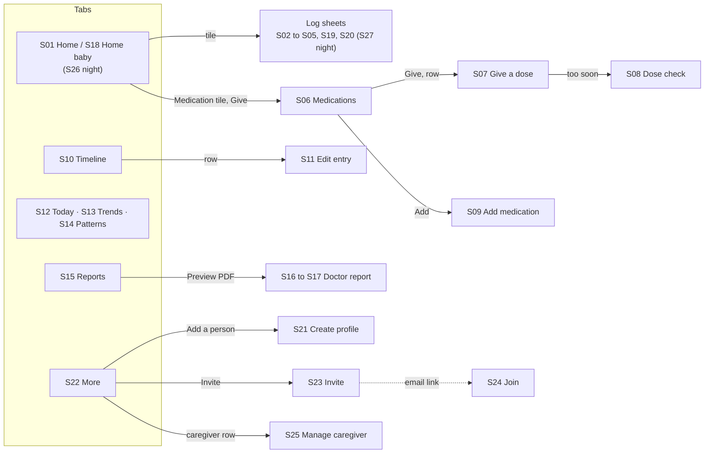

# Behavior Logger: screen-by-screen build notes

Version 1.0 · Oct 27, 2026. These notes go with `PRD.md` and `docs/DESIGN.md`.

Each screen has three files:

- `design/screens/NN-name.html`: open it in a browser, or read the source for exact values.
- `design/screenshots/NN-name.png`
- an entry in `design/screens/manifest.json`

The routes below are suggestions; confirm them in your plan.

**How to read these notes:**

- **"Build"** lists what the screen must do, including the parts the mockup can't show: states, rules and data.
- **"Mockup vs PRD"** lists places where the PRD wins (see also DESIGN.md section 10).
- **Phase 2 screens (S28, S29)** are context only. Don't build them, but keep the entry-type system ready for them (QL-14).

## All screens

| ID | Screen | Route | Phase | PRD |
| --- | --- | --- | --- | --- |
| S01 | [Home (Log tab), Leo](../design/screens/01-home.html) | `/` | MVP | QL-01, QL-07, QL-08, QL-09, BTH-08, MED-04 |
| S02 | [Log bathroom, toilet user](../design/screens/02-log-bathroom.html) | `/?log=bathroom` | MVP | QL-02, QL-03, QL-05, BTH-01 to BTH-07 |
| S03 | [Log eating, meal](../design/screens/03-log-eating.html) | `/?log=eating` | MVP | EAT-01, EAT-04, EAT-06, EAT-07, EAT-08 |
| S04 | [Log activity](../design/screens/04-log-activity.html) | `/?log=activity` | MVP | ACT-01, ACT-02, ACT-03 |
| S05 | [Log mood and behaviors](../design/screens/05-log-mood.html) | `/?log=mood` | MVP | MOOD-01 to MOOD-05 |
| S06 | [Medications list](../design/screens/06-medications.html) | `/meds` | MVP | MED-04, MED-08, MED-09 |
| S07 | [Give a dose (as needed)](../design/screens/07-give-dose.html) | `/meds?give=<medId>` | MVP | MED-05, MED-06, MED-07 |
| S08 | [Duplicate-dose check](../design/screens/08-dose-warning.html) | dialog over S07 | MVP | MED-07, AT-04 |
| S09 | [Add medication](../design/screens/09-add-medication.html) | `/meds/new` | MVP | MED-01, MED-02, MED-03, MED-11 |
| S10 | [Timeline](../design/screens/10-timeline.html) | `/timeline` | MVP | TL-01, TL-03, TL-04, ACC-11 |
| S11 | [Edit an entry](../design/screens/11-edit-entry.html) | `/timeline?entry=<id>` | MVP | TL-02, TL-05, QL-05 |
| S12 | [Insights: Today](../design/screens/12-insights-today.html) | `/insights` | MVP | DSH-01 |
| S13 | [Insights: Trends](../design/screens/13-insights-trends.html) | `/insights/trends` | MVP | DSH-02, DSH-03, DSH-05, DSH-08, DSH-10, DSH-11 |
| S14 | [Insights: Patterns](../design/screens/14-insights-patterns.html) | `/insights/patterns` | MVP | DSH-12, DSH-13, PAT-01, PAT-02, PAT-03 |
| S15 | [Reports (report builder)](../design/screens/15-reports.html) | `/reports` | MVP | RPT-01, RPT-04, RPT-06 |
| S16 | [Doctor report, page 1 (Letter)](../design/screens/16-report-page-1.html) | `/reports/print?…` | MVP | RPT-02, RPT-03, RPT-09, MED-10, AT-13 |
| S17 | [Doctor report, page 2 (Letter)](../design/screens/17-report-page-2.html) | same route | MVP | RPT-02, RPT-03, RPT-08, DSH-13 |
| S18 | [Home, Maya (baby) with Undo toast](../design/screens/18-home-baby.html) | `/` | MVP | QL-01, QL-04, QL-07, QL-09, AT-01, AT-14 |
| S19 | [Log feeding, bottle](../design/screens/19-log-feeding.html) | `/?log=feeding` | MVP | EAT-02, EAT-03, QL-06 |
| S20 | [Log diaper with pale-stool notice](../design/screens/20-log-diaper.html) | `/?log=diaper` | MVP | BTH-01, BTH-03, BTH-05, BTH-06, AT-06, AT-07 |
| S21 | [Create a profile (onboarding step 1)](../design/screens/21-create-profile.html) | `/onboarding/profile` and `/profiles/new` | MVP | ACC-05, ACC-06 |
| S22 | [More tab: people, caregivers, settings](../design/screens/22-more.html) | `/more` | MVP | ACC-04, ACC-07, ACC-10, SET-01 to SET-07 |
| S23 | [Invite a caregiver](../design/screens/23-invite-caregiver.html) | `/more/caregivers/invite` | MVP | ACC-07, ACC-08 |
| S24 | [Join from an invite](../design/screens/24-join-invite.html) | `/invite/[token]` | MVP | ACC-01, ACC-07 |
| S25 | [Manage a caregiver](../design/screens/25-caregiver-detail.html) | `/more/caregivers/[memberId]` | MVP | ACC-08, ACC-09, ACC-10 |
| S26 | [Home, night mode](../design/screens/26-home-night.html) | `/` | MVP (P1) | SET-03 |
| S27 | [Log feeding, night mode](../design/screens/27-log-feeding-night.html) | `/?log=feeding` | MVP (P1) | SET-03, EAT-03 |
| S28 | [Log sleep](../design/screens/28-log-sleep.html) | Not built yet | Phase 2 | QL-14 (Sleep), PAT-08 |
| S29 | [Log a behavior incident (ABC)](../design/screens/29-log-incident.html) | Not built yet | Phase 2 | MOOD-07, QL-14, PAT-09 |

## Navigation map

## Daily logging (child profile)

### S01 · Home (Log tab), Leo

`01-home` · route `/` · MVP · QL-01, QL-07, QL-08, QL-09, BTH-08, MED-04

**Build:**

- **Layout, top to bottom:**
  - A profile switcher pill on the left and a 48 px Maya shortcut on the right.
  - The greeting "How's Leo doing?"
  - A banner: "Melatonin at 7:30 PM · In 25 minutes · 1 mg" with a **Give** button.
  - A 2 × 2 grid of module tiles: Bathroom (alert pill "3 days since BM"), Eating "Ate half · 6:45 PM", Mood "Upset · 5:30 PM", Activity "Playground · loved it".
  - A full-width Medication tile: "2 of 3 given today".
  - Quick taps (P1): Pee, Water, Allergy med.
  - The tab bar.
- **Tile status** comes from the latest entry for that module and profile. It switches to the alert pill when a threshold is reached: days without a BM (BTH-08, AT-10), or a med overdue.
- **Navigation:**
  - A tile opens its log sheet (S02 to S05).
  - The Medication tile opens S06.
  - The banner's **Give** should open S07 for that medication directly, saving a tap; the prototype goes to S06.
- **Banners** follow QL-08 and DESIGN 4.3: up to two, most urgent first, and a dismissed banner doesn't return for the same event.
- **States to add:**
  - first run: "Nothing logged yet" plus three tips
  - offline banner
  - modules turned off for the profile hide their tile (ACC-06)
  - Teen/Adult wording (Appendix A)
  - tile reorder and hide (QL-12, P1)

### S02 · Log bathroom, toilet user

`02-log-bathroom` · route `/?log=bathroom` · MVP · QL-02, QL-03, QL-05, BTH-01 to BTH-07

**Build:**

- **Groups:**
  - **What happened?** Pee / BM / Both. Dry appears only for diaper and toilet-training profiles.
  - **Where?** Toilet / Accident. Training profiles also see Diaper/brief; diaper profiles skip this group (BTH-02).
  - **Consistency:** Bristol 1 to 7 tiles plus "Not sure". Only for BM or Both.
  - **Color:** 7 swatches. Only for BM or Both.
  - **Add details:** size, pain, blood, note, flag for doctor.
- **Progressive disclosure:** choosing Pee hides Consistency and Color, so a pee log is tile → Pee → Save (3 taps, AT-01 pattern).
- **Calm notice:** Red, Black, Pale or Blood shows the BTH-06 notice with **Flag for doctor** (same component as S20). For profiles in diapers, Black only triggers after the first week of life.
- **Stool scale:** follows the toileting setting. Bristol for toilet users and all Teen/Adult profiles; the infant scale for diapers (BTH-03, AT-06).
- **Payload** (PRD section 11): `{ kind: "bm", location: "toilet", scale: "bristol", consistency: 4, color: "brown" }`.

**Mockup vs PRD:** chips are 44 px; build 48. The Bristol chip labels are short; the full Appendix A wording goes in an info sheet.

### S03 · Log eating, meal

`03-log-eating` · route `/?log=eating` · MVP · EAT-01, EAT-04, EAT-06 to EAT-08

**Build:**

- **Groups:**
  - **What kind?** Meal / Snack / Drink. Only the methods enabled for the profile appear (EAT-01).
  - **Which meal?** Breakfast / Lunch / Dinner, picked by time of day (caption "Picked by time of day") and still editable.
  - **How much did Leo eat?** Five portion plates: None, A little, Half, Most, All. These store 0, 25, 50, 75 or 100.
  - **Foods** (EAT-08, P1): multi-select chips from the personal list, recent ones first, plus **Add food**.
  - **Add details:** food groups (P1), new food (P1), reactions, note.
- **Reactions:** "Trouble breathing or swelling" shows the urgent notice "If this is happening now, call 911" (EAT-06). Reactions also appear in the report's flagged events.
- **Drink** swaps the groups for drink type plus amount (EAT-05; not mocked).

### S04 · Log activity

`04-log-activity` · route `/?log=activity` · MVP · ACT-01 to ACT-03

**Build:**

- **Groups:**
  - **What did Leo do?** Icon tiles from the care-stage library (Appendix A), most-used first, plus **New activity** (name and icon only).
  - **How much did Leo enjoy it?** Five faces. Shown after an activity is picked; skippable, and saved as "not rated" when skipped.
  - **How long?** 5, 15, 30 min, 1 hour, 90+ min (ACT-03, P1). The timer option is QL-11 (P1).
  - **Add details:** with whom and where (ACT-04, P2). Hide these until Phase 2.
- **Library:** therapy sessions (OT, speech, ABA, PT) are in it. The mockup groups them as "Therapy".

### S05 · Log mood and behaviors

`05-log-mood` · route `/?log=mood` · MVP · MOOD-01 to MOOD-05

**Build:**

- **Groups:**
  - **How is Leo feeling overall?** Five faces, required, stored as 1 to 5. Labels follow the care stage.
  - **Feelings:** multi-select chips plus **More**, from the stage-specific list. The list is editable in Settings.
  - **Anything notable?** Behavior chips plus **More**. Child and Teen/Adult profiles only.
  - **Intensity:** for each selected behavior, a segmented Mild / Moderate / Severe (MOOD-04, P1). With more than one behavior selected, show one row per behavior.
  - **Add details:** how long, energy (MOOD-05, P1), note, flag for doctor.
- **Reports:** severe behaviors land in the report's flagged events.
- **Payload:** `{ scope: "moment", level: 2, feelings: ["tired","frustrated"], behaviors: [{ key: "meltdown", severity: "moderate", duration_min: 15 }] }`.

## Medications

### S06 · Medications list

`06-medications` · route `/meds` · MVP · MED-04, MED-08, MED-09

**Build:**

- **Header:** a back button, **Add** (to S09), and the title "Medications" with "for Leo · 2 of 3 given today".
- **Sections, in MED-04 order:**
  - **Overdue**
  - **Due:** Melatonin · 1 mg · chewable · nightly, with "Due 7:30 PM" and **Give**.
  - **Later today**
  - **As needed:** Ibuprofen (children's) 7.5 mL, "Last given 6:00 PM by Dad", opening S07.
  - **Given today:** success chips "8:02 AM · Dad" and "12:15 PM · Grandma".
- **Status words:** after the dose window passes with nothing logged, show "Not logged" in a warning chip, never "Missed" (MED-08, AT-05). A late dose can be logged at its real time.
- **"History and dose changes"** opens the medication's change log with "effective from" dates (MED-09). Not mocked.
- **Scheduled doses** are computed from the schedule, not stored as rows (PRD section 11).

### S07 · Give a dose (as needed)

`07-give-dose` · route `/meds?give=<medId>` · MVP · MED-05 to MED-07

**Build:**

- **Header:** the sheet title is the medication name, with "for Leo · as needed" underneath.
- **"Last given" hint** at the top: "Last given 6:00 PM by Dad (1 h 5 min ago) · Your setting: at least 6 h between doses". Use the warning tone inside the interval and neutral text otherwise.
- **Groups:**
  - **Dose:** a stepper with the saved dose (7.5 mL, caption "Saved dose") and a **Half dose** chip. Never suggest a dose (MED-11).
  - **What happened?** Given (default) / Partial / Refused / Spit up / Skipped.
  - **Reason:** as-needed meds only (MED-06).
  - **Add details**
- **Footer:** **Now** and **Save dose**.
- **On save, run the duplicate-dose guard (MED-07).** If it's within the medication's minimum interval (60 min when none is set), or its scheduled slot is already given, open S08. Otherwise save and show the toast.
- **Scheduled meds:** hide Reason and show the slot ("Due 7:30 PM").

**Mockup vs PRD:** add **Constipation** to the reasons (Appendix A).

### S08 · Duplicate-dose check

`08-dose-warning` · dialog over S07 · MVP · MED-07, AT-04

**Build:**

- **Element:** an `alertdialog`.
- **Copy:**
  - Title: "{Medication} was already given {elapsed} ago".
  - Body: "{Caregiver} logged {dose} at {time}. Your setting for {Name} is at least {N} hours between doses."
- **Buttons:**
  - **Don't log this dose:** the default, with focus. It closes and saves nothing.
  - **Log another dose anyway:** saves with `duplicate_override: true`; the override is recorded.
- **Footnote:** "Not sure? Check with {Name}'s doctor or pharmacist."
- **Scheduled-slot version** (not mocked): "Melatonin was already given today at 7:32 PM by Dad."
- **Metric:** track how often the dialog ends in Cancel (PRD goal G5).

### S09 · Add medication

`09-add-medication` · route `/meds/new` · MVP · MED-01 to MED-03, MED-11

**Build:**

- **Fields:**
  - Name (text)
  - Form: chips plus **More**, with the full Appendix A list
  - Dose: a number field with a unit button that opens the unit list
  - **How is it given?** On a schedule / As needed
- **For scheduled meds:**
  - **When:** time chips plus **Add a time**, and weekday toggles S M T W T F S, each labeled with the full day name.
  - The dose window defaults to ±60 min (MED-02) under "More details".
- **For as-needed meds:** a **Minimum hours between doses** stepper (MED-03; not mocked). It drives S08.
- **Optional, under "More details"** (not mocked): purpose, prescriber, instructions, start and end dates.
- **Fixed copy:** the info notice "Enter the dose your doctor or pharmacist gave you. The app never suggests doses." (MED-11). Then **Save medication**.
- **Editing** an existing med reuses this screen. Changing the dose or schedule asks for an "effective from" date and writes a `medication_changes` row (MED-09).

## Timeline and editing

### S10 · Timeline

`10-timeline` · route `/timeline` · MVP · TL-01, TL-03, TL-04, ACC-11

**Build:**

- **Header:** the title and the profile switcher.
- **Filters:** a horizontal row of filter chips: All plus each module.
- **Day groups:** a header ("Today · Mon, Oct 26") with a summary line ("3 meals · mood 3.2 average · meds 2 of 3", TL-04, P1).
- **Rows:** time, module icon, title, detail, badges ("For doctor") and caregiver. Each row opens S11.
- **Live updates** (TL-03, within 5 s): new rows fade in without a refresh.
- **Rows waiting to sync** show a marker (TL-01).
- **Loading:** day by day as the user scrolls.
- **Sample day:** the mockup now includes the 6:00 PM ibuprofen dose (as needed, for fever, by Dad) that S06 and S07 refer to.

### S11 · Edit an entry

`11-edit-entry` · route `/timeline?entry=<id>` · MVP · TL-02, TL-05, QL-05

**Build:**

- **Header:** the sheet title "Mood entry", with "Logged by Mom at 5:32 PM".
- **Rows:** Person, When, Mood, Feelings, Behavior, Note. Each opens the same picker the log sheet uses.
  - Changing Person moves the entry to another profile.
  - Changing When must not allow a future time.
- **Other controls:**
  - the "Flag for doctor" switch
  - the edit history: "6:02 PM · Mom changed intensity from mild to moderate" (TL-05, P1)
  - footer: **Delete** (destructive; asks to confirm; soft delete, TL-06) and **Save changes**
- **Permissions** (ACC-09):
  - Caregivers can edit or delete only their own entries; other people's entries open read-only with a short reason. Not mocked.
  - Viewers always see read-only.
  - The database enforces this, not just the UI (AT-09).

## Insights

### S12 · Insights: Today

`12-insights-today` · route `/insights` · MVP · DSH-01

**Build:**

- **Views:** Today / Trends / Patterns as segmented navigation links with `aria-current`.
- **Cards** (2 columns):
  - Bathroom: "3 days since last BM · At your 3-day alert"
  - Eating: "3 meals · All at breakfast, half at dinner"
  - Mood: "3.2 avg · Lowest at 5:30 PM", with a sparkline
  - Medication: "2 of 3 · Next: melatonin at 7:30 PM"
  - Activity: "30 min · Playground, loved it"
  - Behaviors: "1 meltdown · Moderate · 5:30 PM"
- **Pattern promo:** a card, "New pattern: 4 to 7 PM is hardest", links to S14.
- **Card rules:** each card links to its module's Trends. Cards for modules turned off are hidden.
- **Baby profiles:** wet diapers, plus feeds and volume (not mocked).

### S13 · Insights: Trends

`13-insights-trends` · route `/insights/trends` · MVP · DSH-02 to DSH-08, DSH-10, DSH-11

**Build:**

- **Range:** 7 / 30 / 90 days / Custom. The choice persists across modules (DSH-02).
- **Cards:**
  - **Mood:** headline "Mood is up: 3.4 average since Oct 12, 2.8 before", a daily-average line with the melatonin marker, and the caption "1 = very upset, 5 = great".
  - **Bathroom:** BMs per day, with "none in the last 3 days" highlighted.
  - **Behaviors:** counts before and after.
- **Every chart:** a headline, medication-change markers (DSH-08) and **View as table** (DSH-11).
- **Module coverage:** follow DSH-03 to DSH-07 for each module; only Mood, Bathroom and Behaviors are mocked.

### S14 · Insights: Patterns

`14-insights-patterns` · route `/insights/patterns` · MVP · DSH-12, DSH-13, PAT-01 to PAT-03

**Build:**

- **Cards:**
  - **PAT-03:** "Since melatonin started, Oct 12". Before and after bars (2.8 vs 3.4), "14 days before and 14 days after", **How we calculated this**, and **Add to report** (P1).
  - **PAT-01:** time-of-day bars, with the hardest block highlighted (4 to 7 PM, 2.6) and "Last 30 days · 84 mood logs".
  - **PAT-02:** "On days with no BM, mood averaged 2.7, compared with 3.3 on days with one", with "6 days without a BM, 24 days with".
- **On every card:** the sample size, plus the exact DSH-13 copy "Patterns aren't proof of cause. Share them with your care team." The mockup says "Leo's care team"; the PRD wording wins.
- **Below the minimum data:** show the Keep logging card instead (AT-11).
- **Copy must state the window actually used.** PAT-03 uses 14 days on each side; thresholds are constants (PRD 8.9).

## Reports and the doctor PDF

### S15 · Reports (report builder)

`15-reports` · route `/reports` · MVP · RPT-01, RPT-04, RPT-06

**Build:**

- **For:** profile chips.
- **Date range:** 7 / 30 / 90 days / Custom, with the resolved dates shown ("Sep 27 to Oct 26, 2026").
- **Who is it for?** Doctor visit / Therapist / School, plus **Custom** (RPT-01). Each template has a one-line description and preselects sections.
- **Include:** checkboxes for Medications, Bathroom, Eating, Mood and behaviors, Activities, Flagged notes.
- **Actions:**
  - **Preview PDF:** the print preview (S16 and S17).
  - **Export CSV:** RPT-04.
  - **Share:** the system share sheet (RPT-06, P1).
- **P1:** appointment dates add a "Since last appointment" range (RPT-07). Not mocked.

### S16 · Doctor report, page 1 (Letter)

`16-report-page-1` · route `/reports/print?…` · MVP · RPT-02, RPT-03, RPT-09, MED-10, AT-13

**Build:** a print layout at 816 × 1056. Follow DESIGN.md section 7.

- **Sections:**
  - header and patient block
  - allergies and care notes
  - current medications: "given in period" as "14 of 15 (93%)", following MED-10, plus "Change in this period: melatonin started"
  - a 30-day summary in four boxes
  - the mood chart with the marker and before/after averages
- **Grayscale:** everything must read in grayscale.

### S17 · Doctor report, page 2 (Letter)

`17-report-page-2` · same route · MVP · RPT-02, RPT-03, RPT-08, DSH-13

**Build:**

- **Sections:**
  - **Bathroom chart:** the 3-day band and the marker.
  - **Behaviors table:** usual intensity, usual time of day, count.
  - **Flagged for the doctor:** flagged entries, alerts reached, food reactions, severe behaviors, and refused or vomited doses (RPT-02).
  - **Patterns the app noticed:** only patterns that met their thresholds.
  - **Questions for this visit** (RPT-08, P1).
  - **Footer disclaimer.**
- **Page breaks:** no table row or chart may split across pages.

## Baby profile

### S18 · Home, Maya (baby) with the Undo toast

`18-home-baby` · route `/` with Maya active · MVP · QL-01, QL-04, QL-07, QL-09, AT-01, AT-14

**Build:**

- **Same structure as S01** with baby wording.
- **Banner:** "Last fed 2 h ago · Bottle · 4 oz formula · 5:00 PM" with **Log feed**.
- **Tiles:**
  - Diaper: "Wet · just now"
  - Feeding: "4 oz · 5:00 PM"
  - Mood: "Content · 6:30 PM"
  - Activity: "Tummy time · 15 min"
  - Medication: "Vitamin D given 9:00 AM"
- **Quick taps:** Wet diaper, Dirty diaper, Bottle 4 oz.
- **Toast:** "Wet diaper logged for Maya · 7:12 PM" with **Undo**. It stays at least 5 s, and Undo removes the entry everywhere (QL-04, AT-02).
- **Accent:** switching to Maya changes the accent to teal, plus the header name and sheet titles (AT-14).

### S19 · Log feeding, bottle

`19-log-feeding` · route `/?log=feeding` · MVP · EAT-02, EAT-03, QL-06

**Build:**

- **Groups:**
  - **How?** Breast (hint "Start on right") / Bottle / Solids.
  - **For a bottle:** **What's in the bottle?** Breast milk / Formula / Other; then **How much?**, a stepper at 4 oz with the caption "Same as last feed", plus amount chips.
  - **Add details:** spit up, fussy, note, flag for doctor.
- **Breast** (not mocked, EAT-02): Left / Right / Both, duration chips 5, 10, 15, 20, 30 min, and the timer (QL-11, P1). The "Start on" hint shows the side opposite the last one logged.
- **Solids** goes to the meal flow (S03).
- **Units:** stored in ml and shown in the user's unit (SET-01).

**Mockup vs PRD:** amount chips must be oz 1, 2, 3, 4, 5, 6, 8 or ml 30 to 240 (EAT-03).

### S20 · Log diaper with the pale-stool notice

`20-log-diaper` · route `/?log=diaper` · MVP · BTH-01, BTH-03, BTH-05, BTH-06, AT-06, AT-07

**Build:**

- **Groups:**
  - **What's in the diaper?** Wet / Dirty / Both / Dry.
  - **Consistency:** the infant scale (Watery / Soft / Formed / Hard). Only for Dirty or Both.
  - **Color:** the swatches.
  - **Add details:** size, rash, blowout, note.
- **Notice:** choosing Pale shows the BTH-06 baby notice with exactly this copy: "Pale, white or clay-colored stool in a baby should be reported to your baby's doctor promptly, especially with yellow skin or eyes." It has **Flag for doctor**. The final wording still needs clinician review (D4).
- **Flagging** adds the entry to the next report's flagged events (AT-07).

## Setup, More tab and caregivers

### S21 · Create a profile (onboarding, step 1 of 3)

`21-create-profile` · routes `/onboarding/profile` and `/profiles/new` · MVP · ACC-05, ACC-06

**Build:**

- **Fields:**
  - Name (text)
  - **Age group:** radio cards for Baby / Child / Teen or adult, or **Add a birthday instead**, which sets the stage (ACC-05)
  - **Bathroom:** Diapers / Learning / Uses the toilet (the toileting setting, ACC-06)
  - **Profile color:** five swatches, each with its name as `aria-label`
- **Then:** **Continue**.
- **Steps 2 and 3** (not mocked): confirm modules, pre-checked by stage; optionally add meds or invite a caregiver; then land on Quick Log with three one-line tips (PRD section 7).
- **Avatar:** initials by default. Photo upload is part of ACC-05 but isn't mocked.

### S22 · More tab

`22-more` · route `/more` · MVP · ACC-04, ACC-07, ACC-10, SET-01 to SET-07

**Build:**

- **People you care for:** rows for Leo ("6 years · Child") and Maya ("7 months · Baby"), then **Add a person** (S21).
- **Caregivers:** "You're the admin". Rows for Dad (to S25) and Grandma ("Caregiver · Leo only"; see D12), then **Invite a caregiver** (S23).
- **Settings:**
  - Units and alerts: "oz · BM alert 3 days"
  - Theme and night mode: "Automatic"; the prototype links it to S26
  - Export or delete data
- **Roles:** Caregivers and Viewers don't see invite, role or remove controls (ACC-09).

### S23 · Invite a caregiver

`23-invite-caregiver` · route `/more/caregivers/invite` · MVP · ACC-07, ACC-08

**Build:**

- **Fields:**
  - email
  - **What can they do?** radio cards: Caregiver (default), Viewer (P1), Admin
  - **Who can they see?** profile check cards (D12)
- **Note:** "Invites expire after 7 days. You can remove access anytime."
- **Footer:** **Copy link** and **Send invite**.
- **Invites** store a token with a 7-day expiry (PRD `invites` table).

### S24 · Join from an invite

`24-join-invite` · route `/invite/[token]` (public) · MVP · ACC-01, ACC-07

**Build:**

- **Content:**
  - the brand, and an avatar cluster
  - "Mom invited you to help care for Leo and Maya"
  - a role card with bullets for the role
  - the privacy line
  - "Invite expires Nov 3, 2026"
- **Actions:**
  - **Accept and create account:** sign-up, then land on the active profile's Quick Log (ACC-07).
  - **I already have an account:** sign in, then accept.
- **States to add:** expired, already accepted, revoked.

### S25 · Manage a caregiver

`25-caregiver-detail` · route `/more/caregivers/[memberId]` · MVP · ACC-08 to ACC-10

**Build:**

- **Header:** a 72 px avatar, the name, and "Joined Sep 3, 2026 · last logged today at 8:02 AM".
- **Role:** a segmented control (Admin / Caregiver / Viewer) with a one-line explanation of the selected role.
- **Who can they see?** (D12)
- **Remove from household:** destructive and confirmed, with the copy "They lose access right away. Their past entries stay, labeled with their name." (ACC-10).
- **Then:** **Save changes**.
- **Guard** (not mocked): the last admin can't be removed or demoted.

## Night mode (P1)

### S26 · Home, night mode

`26-home-night` · route `/` with `data-theme="night"` · P1 · SET-03

**Build:**

- **Same as Home, in the night theme,** with these changes:
  - The header shows "Quiet hours" with "Night mode is on until 6:00 AM" underneath.
  - A moon button (amber, labeled "Night mode is on") turns the mode off.
  - "One tap" favorites.
- **Primary buttons** use the profile's night accent with dark text.
- **Sleep pieces wait for Phase 2:** the sleep status card ("Awake since 2:50 AM · Back asleep") and the Sleep tile depend on the Sleep module. Until it ships, night Home shows only the modules that exist.

### S27 · Log feeding, night mode

`27-log-feeding-night` · route `/?log=feeding` at night · P1 · SET-03, EAT-03

**Build:**

- **Layout:** S19 in the night theme.
- **Subtitle:** "for Maya · 3:05 AM".
- **Hint:** "Last feed 10:40 PM · 4 oz".
- **Save:** in teal.
- **No pure white anywhere.**

## Phase 2: context only, don't build in the MVP

### S28 · Log sleep

`28-log-sleep` · Phase 2 · QL-14 (Sleep), PAT-08

**Design intent:**

- **Summary card:** "9 h 15 min asleep · 8:50 PM to 6:30 AM · 2 wake-ups", with a night bar (asleep, awake, settling in).
- **Times:** Into bed, Fell asleep, Woke up.
- **Wake-ups:** a stepper with "25 min awake in all".
- **Quality:** Rough / Okay / Great.
- **Linked dose:** a medication row ("Melatonin 1 mg at 7:32 PM · Given by Dad"), pulled in from the medication log.
- **Add details:** naps, bad dreams, note, flag for doctor.
- **Footer:** a date chip ("Mon, Oct 26").

**Keep ready:**

- The `entries` table should accept `type: "sleep"`, with `occurred_at` = into bed and `ended_at` = woke.
- Proposed payload: `{ asleep_at, wakings: [{ at, minutes }], quality }`.

### S29 · Log a behavior incident (ABC)

`29-log-incident` · Phase 2 · MOOD-07, QL-14, PAT-09

**Design intent:** three chip groups in ABC order, then intensity and duration.

- **Before · what set it off?** Transition, Told no, Loud place, Waiting, Tired, More.
- **During · what did Leo do?** Meltdown, Tantrum, Aggression, Self-injury, Running off, More.
- **After · what happened next?** Comforted, Quiet time, Moved away, Ignored, Got the item, More.
- **How intense?** Mild / Moderate / Severe.
- **How long?** Under 5, 5 to 15, 15 to 30, 30+ minutes.
- **Footer:** a time chip, a note button and **Save**.

**Keep ready:**

- `type: "behavior_incident"`, with payload `{ antecedents: [], behaviors: [], consequences: [], intensity, duration_bucket }`.
- Antecedent counts feed PAT-09.
